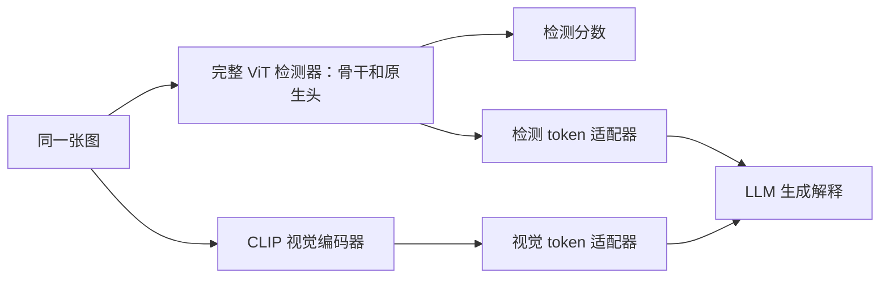

# 重新集成的研究问题与第一轮路线

日期：2026-10-17。此文件是研究路线方案，不是性能实验结果。当前已按用户决定实现第一步 `vit_native` 接入，运行说明见 [SERVER_TEST.md](SERVER_TEST.md)；尚未启动训练或恢复旧融合路径。

## 1. 起点：保留已验证能力，逐项验证融合假设

建议先实现“改进 ViT 完整检测器接入可解释框架”，然后独立判断是否值得加入 CLIP 的检测增量。

“CLIP 与 ViT 的表达差别相当小”不是当前已确立的结论。历史 G24 的源域线性预测只解释了约 26% 的 CLIP 方差，但剩余成分未形成稳定的跨域判别收益；它说明表征差异和任务增量不是一回事。历史结果只覆盖特定冻结特征、读取器和已反复使用的目标集，不能宣称所有 CLIP 用法无效，也不能预设复杂融合一定有效。

两者都可使用 Transformer，训练目标、权重和读取方式仍然不同。需要回答的是：“已经知道 ViT 的预测后，CLIP 是否还有可以在未知数据上利用的信息？”特征余弦、CKA 或强行正交只能辅助描述，不能替代增量实验。

本路线不重启 G29/G29-A/G30，不把它们作为本轮研究依据。

## 2. 原论文与本地代码要分别审计

M2F2 的论文设计包含检测、视觉语言表示、解释模块，并采用检测训练、投影对齐、语言微调的阶段划分。重新集成应保留明确职责和阶段边界，不能把“CNN 改成 ViT”当成整个方法假设。[原论文 §3](https://arxiv.org/html/2503.20188v1#S3)

本地代码目前不是一个可以直接假定一致的整体：

- `sequence/models/M2F2_Det/models/model.py` 的 CNN 版本有 Bridge；`llava/model/deepfake/M2F2Det/model.py` 的 CNN 版本则使用 patch-text 相似度与 CLS/检测特征拼接。
- 本地 CNN Bridge 也含标量 LayerNorm，且桥块放在普通 Python 列表中。后者使这些块不由父模块自动注册，必须检查参数保存、模式切换和设备管理，不能直接拿它作可信基线。
- 现有 LLaVA 实际检测接口把两类输出转为概率，再投影为检测 token。该接口便于最小接入，但不携带空间伪造证据。

上述是本地文件事实，不据此断言公开论文实验无效。第一步需要选定具体官方 checkpoint、配置和实际前向，建立“参考实现”的身份；若修复本地 CNN 实现，须标记为修正版对照，不能冒充原论文精确复现。

## 3. 第一版系统：两条路径，分开承担职责

这是建议的新最小结构，不是原论文的等价重写。

第一阶段，最终检测分数直接来自原生 ViT。接入前后应在同图上复现该分数，允许预先规定的数值舍入误差；训练解释适配器时冻结检测器并保持其推理模式。这样可明确检验有没有在系统接入时损坏既有检测能力。

CLIP 先负责给语言模型提供图像信息，不预设它必须成为第二个真假分类器。解释接入先沿用现有二类检测 token 的概念，完成独立对齐；能输出文字不等于正确、忠实或具有新贡献。

本阶段检测性能按设计与独立 ViT 相同，只完成工程集成。它不回答如何超过 ViT，也不作为融合增益实验。若近期目标仅为提高跨域检测，可先只执行下一节前两步，延后 LLM 训练，避免消耗语言微调预算。

## 4. 最小实验顺序及每步的产物

| 步骤 | 工作 | 要回答的问题 | 明确产物 |
|---|---|---|---|
| A | 独立原生 ViT 重放；冻结 CLIP 的独立读取器；参考 CNN 系统身份核对 | 基线是否正确，是否具备可比较的分数？ | checkpoint 哈希、真实预处理、类别顺序、完整训练/选模来源、同图预测 |
| B | 两支配对错误与分歧分析；简单全局/分数融合 | 有无救回机会？简单规则能否用到？ | 救回/误伤、视频覆盖、逐域 AUC、配对区间；V-only 与 C-only 对照 |
| C | ViT 完整检测器以适配器接回 CLIP/LLM 框架 | 接入后检测是否保持？新增检测信号是否影响语言输出？ | 接入前后分数核对、投影对齐记录、解释对照 |
| D | 仅在 B 有支持时测试受限检测融合 | 复杂交互是否超出简单融合及同容量模型？ | 内容控制、同容量控制、源域选择记录、预先封存测试 |
| E | 若目标包含解释质量，比较二类 token 与检测证据 token | 解释是否使用样本对应的视觉/取证信息？ | 当前图像与错配输入控制、解释正确性与证据依赖评估 |

工程开发可以先建 A/C 接口；训练预算优先投入 A/B。没有结果前不同时推进 D/E。

**A 的关键限制**：`net_050` 的原生头、预处理、PDI 上游训练视频与选模历史必须核实。若骨干已见过拟作验证的视频，重新划分帧或只重训分类头不能制造独立验证。历史权重可用于带明确限制的探索性检查；干净比较需要独立数据，或按固定源域划分重训匹配的骨干。原 CNN、ViT 的数据、预训练与训练预算差异必须报告，不能把优势全部归因于新模块。

**B 的关键限制**：CLIP-only 读取器只能用源训练拟合，在独立源验证选参/阈值。先检查两路互补错误，再用源域选定的简单融合规则评估完整测试集。标签选择的 oracle 只表示潜在救回机会，不是可部署策略；不能在“ViT 错误子集”上拟合或挑选目标域模型。置信度也须验证，不能默认低置信度就是错误。

第一轮不追求门控、跨注意力、特征正交或多重损失。冻结 CLIP 读取器是可解释的低成本参照；已有研究展示它在全生成图像检测中的价值，但该结果不能直接外推到本项目的局部人脸篡改数据。[研究及任务范围](https://openaccess.thecvf.com/content/CVPR2023/html/Ojha_Towards_Universal_Fake_Image_Detectors_That_Generalize_Across_Generative_Models_CVPR_2023_paper.html)

## 5. 根据证据选择后续集成，而不是预先指定 Bridge

| 观察 | 支持的下一步 | 不支持的推断 |
|---|---|---|
| 互补机会小，或样本量不足以排除有用效应 | 保留简单系统；补充有效数据/覆盖，评估结果是否仍不确定 | “两种表征相同”“CLIP 永远无用” |
| 存在多视频、多条件的补救机会，简单融合仍失败 | 只研究一个可检验的问题：源域可学的可靠性规则能否迁移 | 用测试标签选择门控，或强制两支权重相等 |
| 简单融合已稳定有益 | 先保留这个可解释基线，测量其局限后再决定复杂结构 | 把本来由简单融合得到的收益归给 Bridge |
| 真实分支与噪声/同容量控制相当 | 收紧“内容互补”主张，检查是否只是容量/正则作用 | “有梯度或 alpha 非零，所以使用了有用内容” |

分支梯度竞争确实是已有研究问题，但其证据主要来自对应多模态任务；不能因为本项目增益不足就直接套用梯度平衡。冻结骨干时，梯度调制尤其不能凭空增加其输入信息。[适用背景](https://openaccess.thecvf.com/content/CVPR2022/html/Peng_Balanced_Multimodal_Learning_via_On-the-Fly_Gradient_Modulation_CVPR_2022_paper.html)

若做 D，保留可精确退回 `s_V` 的路径，例如 `s=s_V+r(V,C)`，其中 `r=0` 是原生基线。它是受控实验设计，不是性能不下降的保证；旧项目已尝试过残差读法，不能把换名当作新贡献。只按源验证选择幅度与超参数。

## 6. 如果研究目标是“可解释框架”，可做什么集成

更明确、但尚待验证的研究问题是：**ViT 的取证信息能否帮助语言模型给出更依赖当前图像证据的解释？**

第一版仍用二类检测 token 验证接口。只有接口与基础解释评估成立后，才比较 CLS 或少量 patch 证据 token；LLM 投影使用单独模块，不修改 ViT 原生分类头，不强行把 ViT 与 CLIP 向量对齐到同一表示。

至少比较：CLIP 图像 token；CLIP 图像 token + ViT 二类 token；前者 + ViT 特征/证据 token。对新增 token 做去除、异图替换、同类异图替换等干预，同时单独报告检测正确率、解释中真假判断正确率、与检测器一致率和证据依赖。与检测器一致不等于真实正确，检测器出错时不能把“跟着错”当成功。

空间真实性需要空间标注或可信的区域评价；只有二分类标签不能证明热图是正确伪造位置，注意力权重不能直接命名为真实伪造证据。CLIP 同时向 LLM 提供图像 token，因此检测 token 本身信息少也不等于 LLM 完全没有图像信息。

本方向沿用原论文“检测表示与视觉表示分别输入解释模块”的总体思想，是否构成新贡献，取决于新增机制与严格对照，而不是单纯把 CNN 换成 ViT。[原论文解释接口](https://arxiv.org/html/2503.20188v1#S3.SS2.SSS3)

## 7. 防止再次进入长期无结果试验的规则

1. 每一轮先写一个问题、固定比较对象与实际有用的效应阈值、资源预算和停止条件，再运行；此文尚不构成具体真实实验的预注册。
2. 一次只改变一个主要因素。先冻结检测能力检查接口，检测训练和 LLM 训练分别验收，不能用语言 loss 下降证明检测更好。
3. 分类头、预处理、标签方向、冻结/推理模式、加载完整性、样本隔离均有独立检查；前向与推理使用同一检测器类和状态。
4. 目标集不参与选参；过去反复查看的 CD2/DFDCP/Wild 只作历史可比的探索性评测，确认性主张需要新封存数据。FF++ 原视频及关联伪造作为划分/重采样单位，不能沿用人物 ID/帧号冒充视频。
5. 不显著不等于无效或等价。若区间不足以区分实用效应，应报告不确定；不通过无止境换模块寻找单次幸运提升来解决。
6. 一轮结束只允许：证据支持后进入下一步、证据不足后补齐明确缺口、或停止该分支。缺口不明确时不启动更贵的结构。

本次仅写方案与核对论文/代码；未新增模型、未读取服务器新数据、未启动实验。
